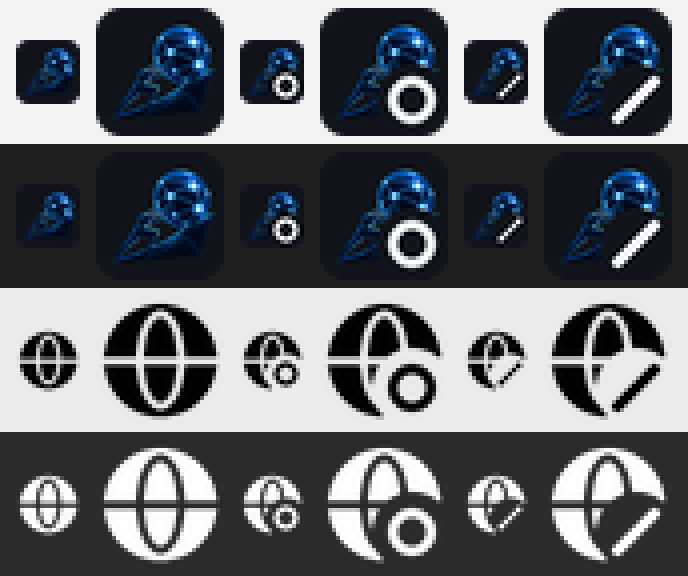

# Using Sisyphus

A walk through Sisyphus as someone using it sees it: start a node, ask it a question, run work on a pool, keep files, and add a second machine. The pictures are of the desktop app; each section ends with the command that does the same from a terminal, because the app and the command line talk to the same node.

The pictures were taken on 10 October 2026 from a development build, against the three-node example backend (`examples/desktop-backend.sh`) planning with a small local model. The app is under active development, so details will have moved.

## What you are looking at

A **node** is one running copy of `sisyphusd`. A **pool** is a group of nodes that work together: one coordinates, and the others, the **workers**, run tasks for it. The **planner** is a language model that a node can ask to turn a question into work for the pool. The desktop app is a window onto one node on your own machine.

Nothing here costs anything or leaves your machines. There is no token and no public network yet; see the [project status](../README.md#project-status).

## Starting

You need the node and, if you want the window, the app.

```sh
make build                                        # builds bin/sisyphusd; needs Go
bin/sisyphusd run --api-listen 127.0.0.1:50051    # a node that is its own coordinator and worker
```

```sh
cd apps/sisyphus
npm install
npm run dev                                       # the desktop app, connected to that node
```

If no node is answering on `127.0.0.1:50051`, the app starts one itself and stops it when you quit. A node it finds already running is used and left alone.

While the app runs a node of its own, it puts an icon in the system tray (the menu bar on macOS). The icon shows the node's state: a plain logo while it is connected, a small hollow ring while it connects, and a slash while it is offline. Its menu and tooltip say the same in words, and the menu has **Open Sisyphus** and **Quit Sisyphus**. Closing the window then leaves the app and its node running, so work for the pool carries on; the first time, the app says so. **Quit Sisyphus** stops the node and the app together. On Linux the icon needs a desktop that shows tray icons (a StatusNotifier host, as KDE and most others have, or GNOME with the AppIndicator extension). Without one, closing the window quits the app as before. A node you started yourself is never kept running by the app: closing the window quits the app and leaves that node alone.




### Installing a packaged build

Without building anything, take a package of the app with the node inside. A release carries them beside the `sisyphusd` binaries, and every run of the `Desktop packaging` workflow on GitHub attaches the same files as development builds.

| System | File | What to do with it |
|---|---|---|
| Windows | `Sisyphus-<version>-win-x64-setup.exe`, or `-win-arm64-setup.exe` on an Arm laptop | Run it. It installs for you alone, asks where, and puts Sisyphus in the Start menu and on the desktop. |
| macOS | `Sisyphus-<version>-mac-arm64.dmg` on Apple silicon, `-mac-x64.dmg` on an Intel Mac | Open it and drag Sisyphus onto Applications. |
| Linux | `Sisyphus-<version>-linux-x86_64.AppImage`, or `-linux-arm64.AppImage` on an Arm machine | `chmod +x` it and run it. |

Each also comes as a plain `.zip` or `.tar.gz` to unpack and run in place.

### The warnings on first run

These packages are not signed by a publisher that Windows or macOS knows, because that takes a paid certificate the project does not have yet. Both systems say so the first time, in words that sound worse than the fact. Check what you downloaded against the release's `SHA256SUMS` first (`Get-FileHash <file>` in PowerShell, `shasum -a 256 <file>` on macOS, `sha256sum <file>` on Linux); a file that matches is the one the project built.

- **Windows, "Windows protected your PC".** Choose **More info**, then **Run anyway**. The publisher is shown as unknown: Windows takes that name only from a signature. Once installed, the app's details (its Properties, and Apps and Features) name it as made by Sisyphus Network, rvnminers-A-and-N and excho0.
- **Windows, the firewall asking about "Sisyphus node".** That is the node inside the app asking to accept connections. Allow it on private networks if other machines are to join yours; a node used alone works without.
- **macOS, "Sisyphus cannot be opened" or "the developer cannot be verified".** Close the message, open **System Settings**, **Privacy & Security**, scroll to the line about Sisyphus and choose **Open Anyway**. On older versions of macOS, right-click the app and choose **Open** instead.
- **macOS, "Sisyphus is damaged and can't be opened".** It is not damaged: macOS says this of an unsigned app that came from a browser. Take the download mark off it with `xattr -dr com.apple.quarantine /Applications/Sisyphus.app` and open it again.
- **Linux** says nothing.

These steps are what each system does with any unsigned program. Nobody on the project has yet walked through them with a released package, so tell us where they are wrong.

For a pool with something in it straight away, `examples/desktop-backend.sh` starts three nodes on one machine and prints how to point the app at them.

## The workspace


The app opens on the workspace. On the left is the conversation with your node's planner. On the right is a globe showing this node and the nodes it knows of, with a count of those it is connected to. The handles between the panes resize them; the clock at the top left opens earlier conversations.

On a narrow window the two become one view with a switch at the bottom. On a machine with no WebGL the globe is left out and the chat takes the room.

## Giving the planner a model

The planner needs a language model before it can answer. Any of these will do:

- a model served by [Ollama](https://ollama.com) on your machine, which costs nothing;
- any service that speaks as OpenAI does, including a local one;
- Claude, with an API key.

Set it in **Settings → Model provider**, or from a terminal:

```sh
bin/sisyphusd model set --model llama3.1:8b       # a model your Ollama already has
```

A small local model works for simple questions and makes mistakes on harder ones; the pool's arithmetic is exact either way, and the steps the planner took are there to check.

## Asking a question


Type a question and press Enter. Until the model starts to answer or to plan, the reply says **Thinking…**. If answering needs computing, the planner writes a job, the pool runs it, and the planner answers from the result. **Finished planning** opens to show what it did: here, one job, with its ID and the result the pool returned. The answer above it comes from that result, not from the model's memory.

While the job runs, the line above says **Running a compute job**, and a tracker under it shows how many of the job's tasks are done, with a row for each worker that has run some: how many it is running and how many it has finished. A task given out again, because the worker running it was lost or ran out of time, is counted as **retried**. Once the job is over, the tracker stays as its summary.

A follow-up that compares two results is given the comparison already worked out, so the model only has to repeat it. If the answer still quotes a number that is one or two digits off a result the pool returned, a **Note** under it gives the job and the number it actually returned ([#532](https://github.com/sisyphus-network/Sisyphus/issues/532)). The result under **Finished planning** is always the pool's own.

The **+** beside the box attaches a file to the question. An attached file is stored sealed, and the job that reads it is private.

From a terminal:

```sh
bin/sisyphusd ask "How many primes are there below 100000?"
bin/sisyphusd ask --chat <id> "And below a million?"      # carry the conversation on
```

## The node


**Node overview** is the machine's own view of the network: its identity, how many nodes it is connected to, and every worker of its pool with its processor, memory, free task slots and the kinds of work it runs. A worker that lends no language model is not shown with `chat`, `embed` or `prompts`: every node takes those jobs in to pass them on, but only a worker with a model runs them. Further down are the node's addresses and the nodes it has found, each of which you can trust for compute or not. Trusting one admits it to your pool as a worker.

A node on a home network knows itself only by an address like `192.168.1.20`, which no table can place, so its country shows as **Not available** and the globe has no marker for it. Node overview and the globe then link to **Settings → This node → Location discovery**, where the node can be allowed to ask your router, a STUN server you name, or a lookup service for its public address ([#573](https://github.com/sisyphus-network/Sisyphus/issues/573)).

You can also say yourself where the node is, as precisely as you like. In the app, **Settings → This node → Where this node is** takes coordinates as a map copies them: right-click a place in OpenStreetMap or Google Maps, copy its coordinates and paste them, as `37.2710, -79.9414` or `37.2710° N, 79.9414° W`. **What other members see** chooses how much of the place other members of a pool may see: the exact place, rounded to about 1 km, rounded to the city, the country only (the default), or nothing. **Save location** keeps it on the node, and your own globe puts this node at the pin rather than in the middle of its country. **Remove pin** forgets it. Without the app, `sisyphusd location set --lat <latitude> --lon <longitude> [--share <share>]` does the same, `location show` prints it and `location clear` forgets it, and so do the local API's `GetNodeLocation` and `SetNodeLocation`.

What the other members of your pool see, for each choice:

| Share | What they see |
| --- | --- |
| `exact` | Your pin as you gave it. |
| `about-1km` | Your pin rounded to 0.01° of latitude and longitude, about a kilometre. |
| `city` | Your pin rounded to 0.1°, about ten kilometres: roughly which town. |
| `country` | No coordinates. Only the country their own node can tell from your address, as before. |
| `nothing` | No coordinates, the same as `country`. |

The rounding is done on your machine, before anything is sent, so the pool never receives more than you chose. Change the pin or the share while the node runs and the pool sees the change at once; one made with `sisyphusd location set` while the node runs reaches the pool the next time it connects. Your own node always shows your pin as precisely as you gave it. On the globe of the node that coordinates your pool, each member that shares a place is drawn there; members that share none are drawn in the middle of the country their address is in, as before.

Hover over any point on the workspace globe to see everything your node knows about it. For this node: its full peer ID, daemon version and listen addresses, its country and how that was found, the city estimate if there is one, and your pin with how much of it you share. For another node: its full peer ID, whether it is connected, its known addresses and the IP addresses in them (the first six of each, then how many more), its country, and whether you trust it for compute, which way work is flowing now, and whether you give it work or take its work. For a member of the pool your node coordinates, also its name, hostname, system, processor and cores, memory, graphics cards, models, how many of its task slots are busy, and the place it shares, with "about city precision" or "about 1 km precision" when the coordinates show how they were rounded. Click a point to keep its card open, so you can select and copy from it; **Copy peer ID** copies the ID, and the close button or Escape closes it. From the keyboard, Tab into the globe pane: each point is also a button, shown when focused, and Enter opens its card. The card shows only what your own node already knows, and asks no one else.

The globe zooms. Use the mouse wheel or a trackpad, pinch on a touch screen, or press the **+** and **−** buttons in the corner of the globe, which also work from the keyboard. It goes from the whole globe at half its size down to a quarter of the Earth's radius above the ground. Brought in past its usual size, it is seen through a round window, and the lines of states and provinces appear, fainter than the country borders. Those lines are Natural Earth's public-domain first-level boundaries, simplified to about 0.9 MB and loaded the first time you zoom in. Lines on the far side of the globe show faintly through it, and not at all once you are zoomed in, so the far side is never mistaken for the near one. The globe turns more slowly the closer you are.

Without a pin, a node can still be placed near its city rather than in the middle of its country. `sisyphusd location city-table download` fetches DB-IP's free city table, some 90 MB, and keeps it on the node; `location city-table status` says which month's it is and `location city-table remove` deletes it. It is downloaded only when you ask, and downloading it shows db-ip.com your machine's address; after that, finding the city asks no one. The city is an estimate, often tens of kilometres off, since an address is placed where the provider's network is. Your own pin always wins over it, and it is not sent to the pool. IP Geolocation by [DB-IP](https://db-ip.com).

In the app, **Settings → This node → City table** does the same. It says whether the table is there and, if it is, which month's edition, how large it is and when it was downloaded. **Download** fetches it, which can take a few minutes; **Update** downloads it again, so that DB-IP's latest edition takes the place of the one kept; **Remove** deletes it. Once the table can place the node, the card says where, as in "This node looks to be near Louisville, Kentucky, US". It places a node only by its public address, so a node on a home network that has not found its public address is not placed until **Location discovery** finds it. With a pin set, the card says the pin is used instead. The card carries the credit the table's licence asks for, which opens [db-ip.com](https://db-ip.com).

```sh
bin/sisyphusd id
bin/sisyphusd nodes
```

## Running a job from a form

**Run** lists what your pool can compute, one card for each workload that describes its parameters as a form: **Count primes**, **Count words**, **Re-encode video**, **Simulate a molecule**, and **Render a 3D scene**, which renders a Blender file's frames across the pool, or one frame in strips that are put back together. Each card says what the workload does and how many workers can run it. A workload no worker runs yet says **No worker runs this yet**: you can still open it and fill it in, but it cannot start until such a worker joins. Workloads without a form are listed below the cards; they take JSON, so submit them from **Operations → Jobs**.

Open a card to see its form. Every field starts at a value the workload accepts, so most jobs are a file and a click:

- **A file** is dropped on its drop zone, or chosen with it, and is stored in the pool for the job to read. A file you stored before can be picked from the list under it.
- **Numbers** are checked as you type, against the bounds and steps the workload gives, and a value it would refuse is said so under its field.
- **Choices** and **toggles** are a list and a switch.

**Simulate a molecule** takes a molecule as a PDB file, or, if you prepared a system with Amber's tools, its **Amber topology (prmtop)** and **Amber coordinates (inpcrd)** files in place of it. Give both of those or neither, and leave **Molecule** empty when you do. An Amber system is simulated as it is, with the force field its topology holds: nothing is added to it, and its own box, if it has one, is kept. **Simulate a molecule** has a **Use a graphics card** switch. With it on, each replica runs on a worker's NVIDIA graphics card, many times faster, one replica per card at a time while the worker's other slots take other work. Only workers with a card are given the job, and it waits while none is connected. Such a worker needs Docker able to use the card: on Windows, Docker Desktop with the WSL 2 backend and a current NVIDIA driver; on Linux, the NVIDIA Container Toolkit. The first replica on a worker builds a larger image, once. There is no thread count to set. The [node's README](../apps/sisyphusd/README.md#molecular-dynamics) has the details.

**Run** starts the job, spread across the pool's workers, and the page follows it: its tasks done, what each worker is doing, and then its result, with any files it wrote to save. Each file is offered under its own name and saved with a type your programs know: a re-encoded video as `.ts`, which VLC and most players open; a simulated molecule's last frame, energies and trajectory as `.pdb`, `.csv` and `.dcd`; a file a container wrote under the name it gave it. A file the result does not name is typed by its contents. A molecule simulation's result is shown as a summary: how many replicas of how many atoms, for how long, the mean final energy and its spread, and a row for each replica with its seed, where it ran, how fast, and its final energy. The result as the pool returned it is still there, folded, below it. **Change and run again** brings the form back with the same values. The jobs you start this way are listed under **Recent jobs** until the app is closed; every job is also in **Operations → Jobs**.

The names of the fields and the sentence under each come from the node, and are in English for now.

## Running a job yourself


**Operations → Jobs** submits work without the planner. Choose the workload, give its parameters as JSON, and say how the work is to be spread: **Distributed** splits it across the pool's workers. `Tasks` at 0 lets the node decide how many pieces to cut it into.


Jobs appear below the form as they run, newest first, each with its state, its progress, its log and its result.

**Private job** seals what the job reads and writes. Workers are given the keys for that job's data and nothing more. The key itself, `private.key` in the node's data directory, is the only way back to sealed data: if it is lost, so is the data.

```sh
bin/sisyphusd job submit --params '{"from":0,"to":100000}'
bin/sisyphusd job get <job-id>
bin/sisyphusd job logs <job-id>
```

## Files


**Operations → Files** stores files in the pool for jobs to read. Each is named by a content identifier, the long string under its name, which is a fingerprint of its bytes: the same file always has the same one, and a file cannot be swapped for another under it. Tick **Encrypt as a private file** to seal a file before it is stored; only private jobs can read it.

```sh
bin/sisyphusd blob put notes.txt
bin/sisyphusd job submit --workload wordcount --params '{"input":"<cid>"}'

bin/sisyphusd key new job.key                                 # a key of your own, for sealed files
bin/sisyphusd blob put --key-file job.key notes.txt
bin/sisyphusd job submit --workload wordcount --key-file job.key --params '{"input":"<sealed-cid>"}'
```

## Adding another machine


A second machine joins your pool by invitation. **Operations → Pool → Invite worker** prints one; it can be used once, within the time you choose. On the other machine:

```sh
sisyphusd run --role worker --coordinator <your-address>:7700 --join <invitation> --name <a-name>
```

Two things to know:

- **Your node must be listening where the other machine can reach it.** A node the app starts for itself listens only on your own machine until you turn on **Let other machines join this pool** in **Settings → This node** (see [Settings](#settings)). A node you start yourself listens where its `--listen` says, such as `--listen 0.0.0.0:7700`. Either way, open TCP port 7700 to the other machine.
- **Invite client** is for a machine that submits work and stores files but runs none.
- **A machine with Ollama can lend its models.** Add `--models-from http://127.0.0.1:11434`. Its owner decides what the pool gets: `--models-only llama3.1,qwen3:8b` offers only those, `--models-gpu-layers 0` keeps the pool's work off the graphics card, and `--models-keep-alive 0` frees the model's memory as soon as it has answered. `sisyphusd nodes` then shows each model and how much of it is on the card. Some limits only Ollama itself can be told; the [daemon guide](../apps/sisyphusd/README.md) lists them.
- **On Windows**, the first run of `sisyphusd.exe`, or of the app, may bring up "Windows protected your PC" and then the firewall asking about "Sisyphus node"; see [the warnings on first run](#the-warnings-on-first-run).

Members are listed underneath, and **Remove** takes one out. A member can also take itself out, from its own machine, with `sisyphusd pool leave --addr <coordinator>`: the coordinator then lets go of the files it kept there for that machine, as **Remove** does. A machine whose node was started to work for another's pool (`--role worker --coordinator …`) has **Leave pool** under **Joined pool** on **Node overview**. It asks first; once the pool has let go, the node forgets that pool and stops. Start it with another pool's `--coordinator` and an invitation to join that one. [Testing a pool across machines](multi-machine-test.md) goes through all of it step by step, including what to do when a machine will not join.

```sh
bin/sisyphusd pool invite
bin/sisyphusd pool members
```

## Settings


**Settings** holds what belongs to the window (language, theme and accent, which are kept on this device) and the planner's model, which is kept on the node. The app is in seven languages, two of them written right to left.

**Let other machines join this pool**, under **This node**, is off until you turn it on. When it is on, the node the app starts takes workers at the address and port you choose, port 7700 unless you change it. The address list shows this computer's own addresses, those on a home or office network first. **All interfaces** is there too, but it also opens the port to a VPN or a public Wi-Fi network the computer happens to be on. Hosting also turns on discovery, so other Sisyphus nodes can find this one, with its ID and addresses. Being found admits no one: a machine still joins only with an invitation from your pool, and the app's own control connection stays on this computer. The change applies when the node next starts: **Restart node**, beside **Save**, restarts it now. If the chosen address is no longer this computer's when the app starts (on another Wi-Fi network, say), the node listens only on this computer and the setting says so. While the node hosts, **Node overview** shows the address workers give as `--coordinator`, with a button to copy it, and how to let them through the firewall. On Windows that is a command to run once in PowerShell opened as administrator, which opens only the pool port and only on private networks. The setting is for the node the app starts. A node you started yourself listens where its `--listen` says.

**Run containers for the pool**, under **This node**, is off until you turn it on. When it is on, the node the app starts runs the pool's container work on this computer: **Re-encode video** (`transcode`), **Simulate a molecule** (`md`), **Render a 3D scene** (`render`) and `container` jobs, which only workers that run containers take. That means anyone who may submit jobs to your pool can run a container image of their choosing here, so turn it on only for a pool whose members you trust with that. It needs [Docker](https://docs.docker.com/get-started/get-docker/): Docker Desktop on Windows and macOS, which is free for personal use (larger companies need a paid subscription), or Docker Engine on Linux. The app asks Docker before the switch can be turned on. If Docker is not installed, or is installed but not running, the setting says which, with **Get Docker** and **Check again** buttons. The work is confined by these options:

- **Allow tasks to use the network** is off. A task then reaches neither the internet nor your local network, and a job that asks for the network waits for a worker that allows it. Re-encoding, molecular dynamics and rendering need no network. Turn it on only for jobs you trust that need it.
- **Read-only root** is on. A task can write only to its output and to `/tmp`, so it cannot change the image it runs in. Re-encoding, molecular dynamics and rendering work this way. An image that writes elsewhere fails, and turning this off lets it.
- **Size of /tmp (MB)** is 1024. It is the most a task may write to `/tmp`, which is held in memory, so keep it below what this computer can spare.

The change applies when the node next starts: **Restart node**, beside **Save**, restarts it now, and the **Run** page then counts this computer among the workers for those workloads. If Docker is not answering when the node starts, the node starts without containers and the setting says so: start Docker, then restart the node. The setting is for the node the app starts. A node you started yourself runs containers if you gave it `--containers`, with its own `--containers-*` options.

**Lend this machine's models** offers the models of an Ollama on this machine to the pool, without the command line:

1. Turn lending on. The address starts as `http://127.0.0.1:11434`, an Ollama on this machine; change it for one elsewhere. **Check connection** shows the models it has and which are loaded now. Saving checks too, and so does opening the page while lending is on.
2. Tick the models to offer. Then set the limits:
   - **GPU layers:** how much of a model goes on the graphics card. `0` keeps the pool's work off it, `-1` puts on as much as fits.
   - **CPU threads**, **context length**, and **keep loaded**, which is how long a model stays in memory after it answers.
3. Save.

Changes to the models and the limits apply at once. Turning lending on or off, or changing the address, needs the node restarted. The page says when, with a **Restart node** button. A few limits belong to Ollama itself rather than to Sisyphus, such as how many models it keeps loaded and which graphics cards it may use; the section lists them and how to set them on Windows, macOS and Linux. If the node was started with `--models-from`, those flags decide, and the saved settings wait for a start without them.

**Restart node** appears beside **Save** wherever a saved setting waits for the node to start again, for the node the app started. If the node is running jobs or has workers connected, it first says how many and asks; otherwise it restarts at once. A restart stops running jobs and disconnects workers until they reconnect. The app reports success and reloads the settings only after the node reconnects; if it does not reconnect within 30 seconds, the app reports a failure instead. A node you started yourself is restarted where you started it.

**Access** lets browsers on other machines use this node, which is off until you turn it on. Pick which of the machine's network addresses to serve on. Browsers then reach the node over HTTPS, with a certificate the node makes for itself, so each one warns about it the first time: compare the fingerprint shown here before accepting. **Devices** then pairs a browser with a one-time code, and lists the paired ones so you can revoke them.

## Checking results

A pool of your own machines can be taken at its word. One with other people's machines in it cannot, and a job can ask to be checked:

```sh
bin/sisyphusd job submit --verify 2 --params '{"from":0,"to":100000}'          # two workers must agree
bin/sisyphusd job submit --audit-share 0.2 --params '{"from":0,"to":100000}'   # this node reruns a fifth itself
```

What each of these catches and what it does not is in the [node's README](../apps/sisyphusd/README.md#verifying-results) and the [security model](security-model.md).

## From an AI agent

The node is also an MCP server, so an agent such as Claude Code can use the pool as a tool:

```sh
claude mcp add sisyphus -- sisyphusd mcp
```

The skill in `skills/sisyphus` tells an agent how to use it well. Both are described in the [node's README](../apps/sisyphusd/README.md).

## Where to go next

- [The node's README](../apps/sisyphusd/README.md): every command and option.
- [Testing a pool across machines](multi-machine-test.md): a real pool on real machines.
- [The security model](security-model.md): what is protected, and what is not yet.
- [The desktop app's README](../apps/sisyphus/README.md): building and packaging the app.
